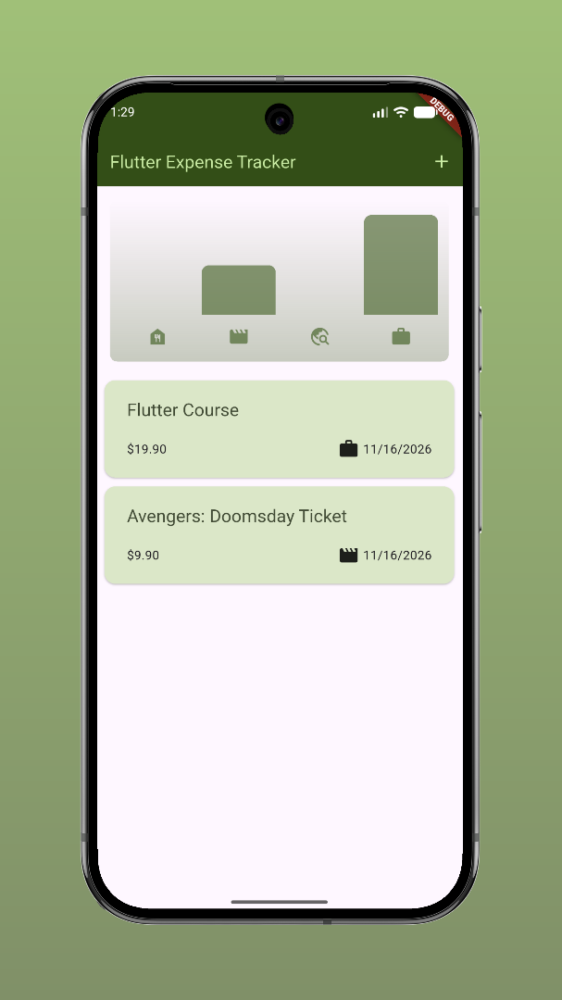
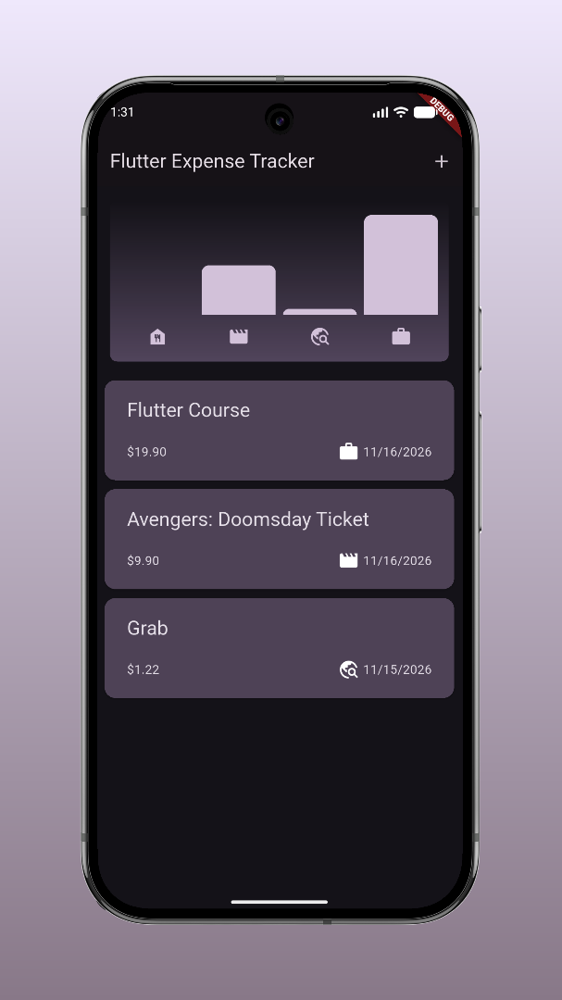
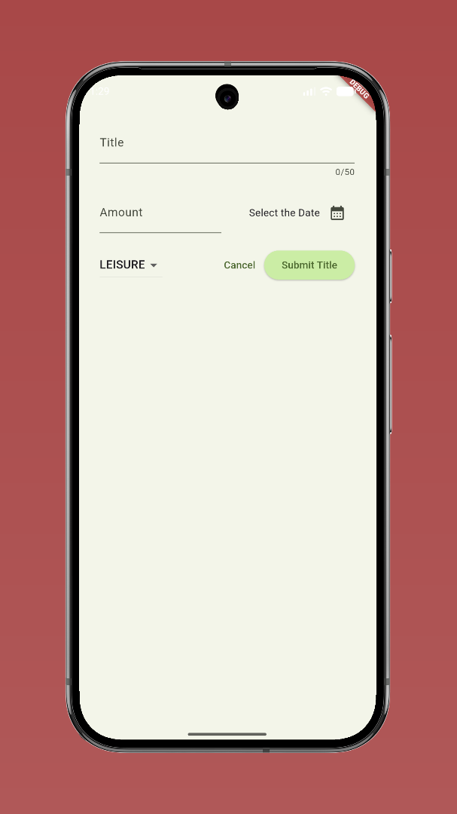

# Expense Tracker

A clean, responsive expense tracking app built with Flutter as part of my Flutter development course.

## Screenshots

| Light Mode | Dark Mode | Add Expense |
| :---: | :---: | :---: |
|  |  |  |

## Features

- Add, view, and swipe-to-dismiss expenses with undo support (`SnackBar`)
- Category-based expense breakdown bar chart
- Automatic light and dark theme adaptation
- Input validation and native date picker

## What I Learned

1. **App Structure & UI:** `AppBar`, `ListView`, `Expanded`, `Card`, and `showModalBottomSheet`
2. **Data Modeling:** Custom `Expense` & `ExpenseBucket` classes, `uuid`, initializer lists, and `enum`
3. **Collections & Formatting:** `Map`, `for` loops, `.map()`, spread operator (`...`), getters, and date formatting
4. **User Input & Validation:** `TextEditingController` (with `dispose()`), `DropdownButton`, `.trim()`, and `double.tryParse()`
5. **Async & State:** `Future` / `async` with `showDatePicker`, lifting state up via callback functions, and `ThemeData`